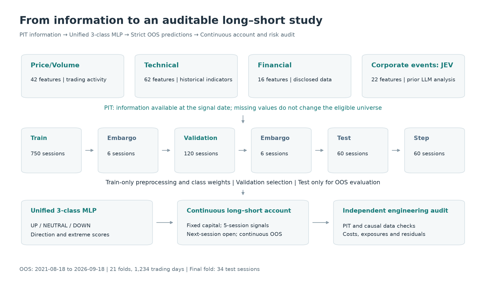
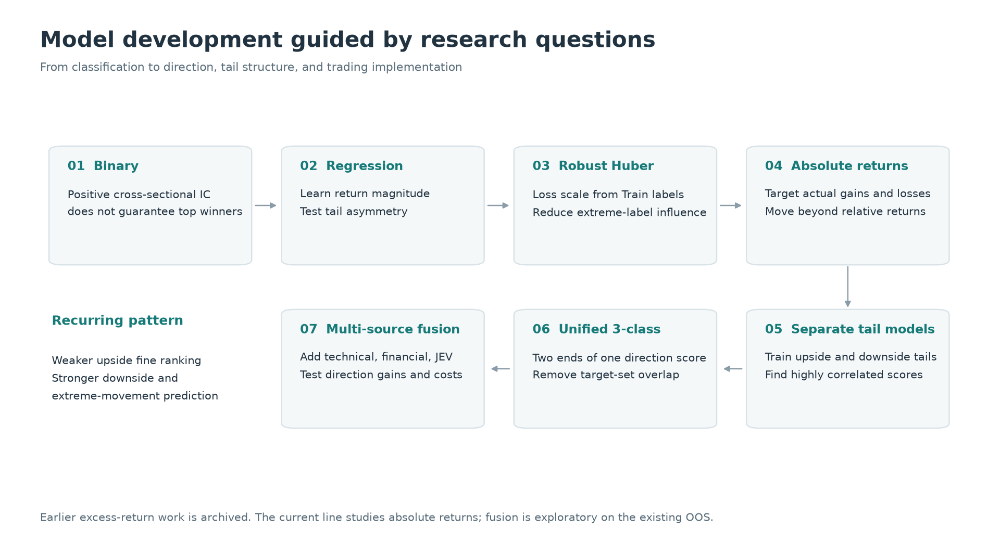
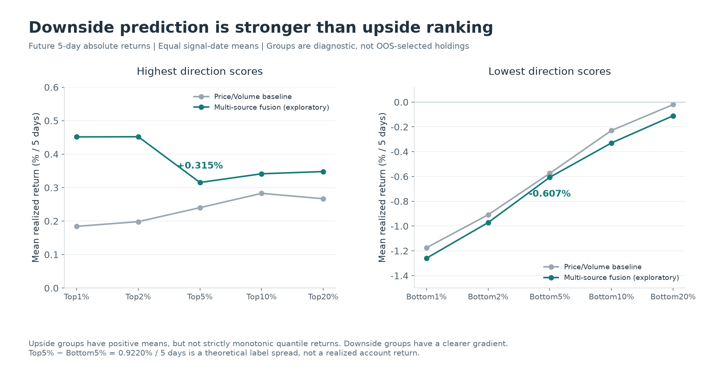
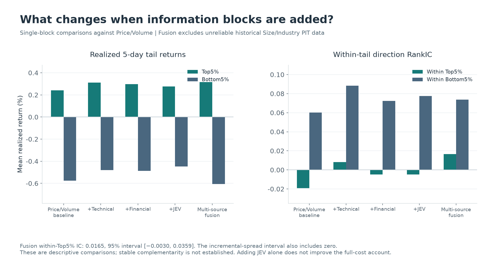
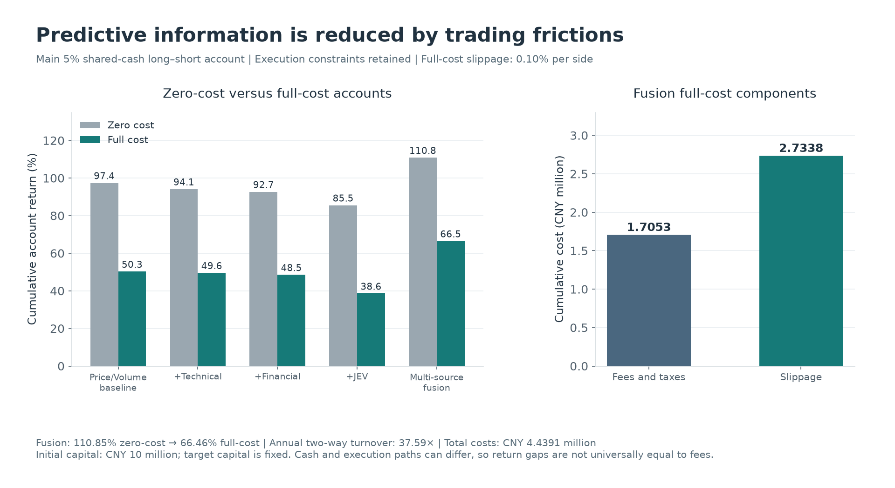
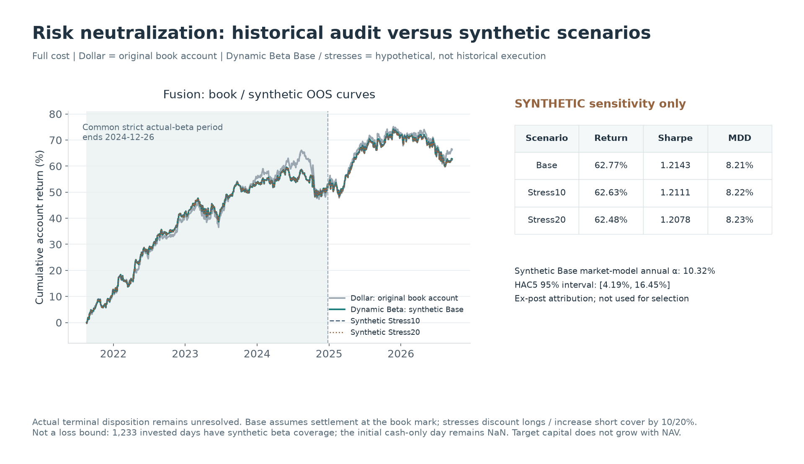

English | [中文](README_CN.md)

# Neural Cross-Sectional Return Prediction and Long–Short Portfolio Research with Multi-Source Information

**CSI 1000 · Walk-Forward Validation · MLP · LLM-Derived Corporate Events · Long–Short Portfolio · Risk Analysis**

One question kept coming up in my earlier quantitative research: **can a neural network extract return signals from A-share trading data, fundamentals, and corporate announcements that actually survive out-of-sample testing?** This project started as my attempt to answer that question.

I began with a simple price/volume MLP, then explored absolute-return classification, multi-source fusion, long–short portfolios, trading costs, and risk neutralization. More than any single return curve, I wanted to understand what the model had learned—and how much of that information remained useful once trading constraints were introduced.

## 01 At a glance

**Research question:** Can additional information improve the model's identification of rising and falling stocks while preserving its stronger downside prediction?  
**Universe and period:** Historical CSI 1000 constituents; OOS from 2021-08-18 to 2026-09-18, across 21 folds and 1,234 trading days.  
**Approach:** Price/volume MLPs, classification, regression, and robust regression, followed by an absolute-return UP / NEUTRAL / DOWN classifier with technical, financial, and LLM-derived corporate-event features.  
**Main finding:** Downside-tail and extreme-movement prediction are stronger than fine-grained ranking within the upside tail. Fusion improves some direction metrics and the theoretical long–short spread in this sample.  
**Evidence boundary:** Fusion is an exploratory follow-up on the existing OOS period. Synthetic terminal-inventory scenarios remain separate from the strict historical audit.

## 02 Why I started this project

My starting point was not to train the model with the highest backtest return. I wanted to answer two questions: **does a positive cross-sectional rank correlation actually identify the best-returning stocks? And how much predictive advantage remains after turnover, slippage, and failed executions?**

I examined these questions along one chain:

**Predictive signal → Tail quality → Portfolio construction → Execution → Net return and risk**

A single RankIC or cumulative-return curve cannot answer both. I evaluate full cross-sectional rankings, local Top/Bottom performance, and a continuous account together.

## 03 Data and information sources

| Feature block | Size | Information and role |
| --- | ---: | --- |
| Price/Volume | 42 features | Historical prices and trading activity; the common baseline across models |
| Technical indicators | 62 features | Trend, volatility, and trading-state information derived from historical market data |
| Financial fundamentals | 16 features | Financial information already disclosed at the time, adding company quality and operating context |
| Corporate events: JEV | 22 features | Existing LLM-derived corporate-event features, including event direction and importance |

The final fusion model uses these four blocks: 142 candidate features, with 139 retained during training. Three financial features remain missing because the underlying fields are unavailable. Missing-value treatment is fitted on the training set; stocks are not dropped to improve feature coverage.

JEV is aligned point-in-time to when announcements become available. I reuse completed announcement analyses rather than making new LLM calls during model training. The raw announcement collection, prompts, and detailed scoring implementation are not disclosed.

Reliable historical PIT changes in size and industry membership are not yet available. I therefore exclude these blocks rather than backfill history with a current industry snapshot, and retain this gap as a research limitation.

## 04 A strict walk-forward design

The prediction target is the stock's **absolute return from the T+1 open to the T+6 open**. The windows advance on actual trading days:

**Train 750 → Embargo 6 → Validation 120 → Embargo 6 → Test 60 → Step 60**

The last fold contains only 34 test trading days because of the data cutoff.

Within each fold, preprocessing and class weights are fitted on Train only. Validation is used for hyperparameter selection and early stopping; Test is reserved for OOS prediction and evaluation. Final retraining preserves the preprocessing state fitted on Train. Constituents, financial disclosures, and announcements are handled according to the information available at the time.

The continuous account uses predictions for all 1,234 trading days. Future-return diagnostics exclude end-of-sample observations whose labels have not matured. Tail-return statistics cover 246 signal dates with mature labels, while direction and magnitude IC use daily mature cross-sections. These are different evaluation frequencies, and I do not treat them as interchangeable evidence.

## 05 How the models evolved

I first used binary classification to predict whether a stock would outperform the benchmark. A problem soon emerged: **a positive full cross-sectional RankIC does not imply that the highest-scoring stocks earn the highest returns.** This led me to test continuous-return regression, so the model could learn return magnitude rather than only an outperformance label.

After introducing Robust Huber Regression, one pattern kept recurring: **the model identified poor future performers more effectively than it ranked the strongest winners within the upside tail.** I reconsidered the target and moved from benchmark-relative excess returns to stock absolute returns.

I then trained separate Upside and Downside models. Their scores were highly correlated, and they often selected the same stocks. This suggested that price/volume features might be identifying future extreme movement before identifying its direction.

I combined the two models into a unified **UP / NEUTRAL / DOWN classifier**. UP and DOWN require a stock to be in the highest or lowest 10% of future returns within that date's cross-section, respectively, and to have a positive or negative realized return. The remaining observations are NEUTRAL.

The model uses:

- `direction_score = P(up) − P(down)`: the relative tilt toward the upside or downside tail;
- `extreme_score = P(up) + P(down)`: a score used to investigate future large moves.

Selecting the two ends of one ranking removes overlap between the long and short target sets. Whether that ranking captures useful direction is still tested against realized future returns and a continuous account.

## 06 Main findings

| Aggregate metric | Price/Volume 3-class baseline | Multi-source fusion |
| --- | ---: | ---: |
| Top5% future 5-day absolute return | +0.2401% | +0.3153% |
| Bottom5% future 5-day absolute return | -0.5749% | -0.6067% |
| Top5% − Bottom5% theoretical spread | +0.8150% | +0.9220% |
| Within-Top5% direction RankIC | -0.0192 | 0.0165 |
| Within-Bottom5% direction RankIC | 0.0602 | 0.0738 |
| Mean daily cross-sectional direction RankIC | 0.0691 | 0.0732 |
| Mean daily extreme-movement RankIC | 0.3007 | 0.2933 |

Tail returns are equally weighted across actual signal dates. Within-group RankIC is the Spearman correlation between `direction_score` and realized absolute return. Extreme-movement RankIC relates `extreme_score` to the absolute magnitude of the future return.

### 1. The downside tail is easier to predict than the upside tail

This is one of the most persistent observations in the project.

The downside groups show a clearer return gradient: stocks ranked as worse generally have lower future returns. Upside groups have positive average returns, but fine-grained ranking within the upside tail remains much weaker.

With fusion, within-Top5% RankIC rises to 0.0165. Its HAC lag-5 95% interval is still **[−0.0030, 0.0359]**, so a stable positive improvement is not established. Average returns across upside quantiles are also not strictly monotonic.

### 2. The model contains information about future extreme movement

The mean daily correlation between `extreme_score` and future absolute return magnitude is approximately 0.29–0.30. This supports the presence of magnitude information, but anticipating a large move is different from identifying its direction.

### 3. Fusion helps in this sample, but individual blocks do not automatically add alpha

Adding technical, financial, or announcement information individually increases the Top5% mean return, but does not improve every metric. For example, the JEV-only addition produces a full-cost cumulative return of 38.57%, below the price/volume baseline's 50.27%. It does not establish that LLM-derived corporate-event features independently generate stable alpha.

Fusion increases the theoretical long–short spread over the price/volume baseline by **0.1071 percentage points per 5 days**. The paired, same-date HAC lag-5 95% interval is **[−0.1226, +0.3368] percentage points**. It includes zero, and there is no multiple-testing correction.

I treat this as **suggestive exploratory evidence**, rather than an independently confirmed conclusion.

## 07 From prediction to trading

The main account is fixed at **Long Top5% + Short Bottom5%**. Each side is equally weighted within a shared cash account. Signals occur every 5 actual trading days and execute at the next session's open. The account, realized inventory, and rebalance grid remain continuous across folds.

The backtest retains T+1, board-lot, cash, suspension, price-limit, and corporate-action constraints. Full cost adds commissions, historical stamp duty, transfer fees, and **0.10% slippage on each buy and sell side**. Zero cost removes fees and slippage while retaining execution constraints.

| Main 5% account | Cost version | Cumulative return | Sharpe | Maximum drawdown |
| --- | --- | ---: | ---: | ---: |
| Price/Volume baseline | Zero cost | 97.40% | 1.5837 | 8.72% |
| Price/Volume baseline | Full cost | 50.27% | 0.8142 | 14.11% |
| Multi-source fusion (exploratory) | Zero cost | 110.85% | 1.9737 | 8.82% |
| Multi-source fusion (exploratory) | Full cost | 66.46% | 1.1788 | 11.30% |

This stage made the gap between prediction and execution concrete: **predictive information does not translate fully into tradable returns.**

The fusion full-cost account has approximately 37.59× annualized two-way turnover. Against CNY 10 million in initial capital, fees and taxes total approximately CNY 1.7053 million, slippage CNY 2.7338 million, and combined trading costs CNY 4.4391 million. Trading frictions substantially erode gross alpha.

The theoretical Top5%−Bottom5% spread of 0.9220% per 5 days is not an account return. An idealized 50% long / 50% short portfolio contributes only half that spread in a single period. The realized account is also affected by continuous holdings, failed fills, and its cash path.

## 08 Risk neutralization and sensitivity

Equal long and short capital does not imply market beta neutrality. The two sides can have different market exposures. I therefore compared dollar-neutral and dynamic-beta allocation, and examined the gap between target weights and actual holdings after execution.

This uncovered a terminal-inventory problem: the available records could not establish how two securities remaining after long suspensions were actually settled. Rather than fill the gap to extend the curve, I retain the strict actual-holdings beta audit only through 2024-12-26. Existing accounts and models remain archived unchanged; residual positions were not deleted, beta was not forward-filled, and market prices were not invented.

> **Dynamic Beta Base, Stress10, and Stress20 below are synthetic / hypothetical accounting scenarios. They align the comparison period and test sensitivity; they are not historically executable performance.**

| Fusion full-cost account | Evidence level | Cumulative return | Simple annual return | Sharpe | Maximum drawdown |
| --- | --- | ---: | ---: | ---: | ---: |
| Dollar-neutral | Original frozen book account; full-OOS actual-holdings beta unverified | 66.46% | 13.58% | 1.1788 | 11.30% |
| Dynamic Beta Base | **Synthetic assumption** | 62.77% | 12.83% | 1.2143 | 8.21% |
| Dynamic Beta Stress10 | **Synthetic assumption** | 62.63% | 12.80% | 1.2111 | 8.22% |
| Dynamic Beta Stress20 | **Synthetic assumption** | 62.48% | 12.77% | 1.2078 | 8.23% |

Base settles residual inventory at its existing book valuation. Stress10/20 apply 10%/20% discounts to long settlement prices and equivalent premiums to short covering prices. Their results are close to Base. This indicates limited sensitivity to these fixed assumptions—not that a 20% shock bounds real terminal losses.

In the synthetic Base scenario, the **ex-post annualized market-model alpha is 10.32%**, with a HAC lag-5 95% interval of [4.19%, 16.45%] and market beta of −0.0257. This attribution uses daily NAV returns, whereas headline performance uses a fixed-initial-capital convention. The ex-post fit is never used for trading parameter selection.

For the fusion model, dynamic-beta allocation gives up some cumulative return while reducing drawdown and raising Sharpe. The price/volume baseline does not show the same overall improvement. Lower beta exposure does not automatically make every model better.

## 09 Limitations

I view these results as a stage in a broader research process, rather than evidence that the strategy can be implemented as-is in the live A-share market. The current limitations are explicit:

- Short positions assume stock is borrowable, with zero borrow fees; recalls, margin requirements, and forced liquidation are not fully modeled.
- Reliable historical industry PIT data are unavailable, so industry neutralization is not yet implemented.
- Phase 3F fusion was proposed after observing the existing OOS results. It is an exploratory follow-up, not a new independent confirmation test.
- Phase 4C is a synthetic accounting sensitivity study; historical data still do not resolve actual terminal disposition.
- The intervals for within-upside-tail ranking and the incremental fusion spread include zero.
- High turnover, slippage, and execution constraints remain major barriers between gross and net alpha.

These limitations help define the next questions I want to investigate.

## 10 Next steps

I would pursue two directions: better modeling of temporal and multimodal information, and portfolios that bring predictive signals closer to executable decisions.

| Direction | Research objective |
| --- | --- |
| TCN / Transformer | Move beyond static MLPs to price/volume sequences, modeling temporal dependence and changing market states |
| Multimodal fusion NN | Encode price/volume sequences, technical indicators, fundamentals, and corporate events separately, then combine them through a fusion layer |
| Multi-task learning | Train a Direction Head and a Magnitude Head together, asking which way prices may move and how far |
| Portfolio optimization | Incorporate beta, reliable historical industry information, turnover, and transaction costs into portfolio constraints |
| Independent validation | Test fusion increments on a new, previously unobserved period, while improving borrow and terminal-disposition assumptions |

The longer-term direction is:

**Neural signal → Risk model → Portfolio construction → Execution**

## 11 Tools and methods

Python · PyTorch · Pandas · NumPy · Walk-forward research · PIT alignment · LLM-derived corporate-event features · Continuous-account backtesting · Independent artifact-integrity and execution-risk checks

This public version presents research methods, aggregate evidence, and limitations. Sources, figure conventions, and disclosure scope are documented in the [public disclosure audit (Chinese)](PUBLIC_DISCLOSURE_AUDIT.md).
