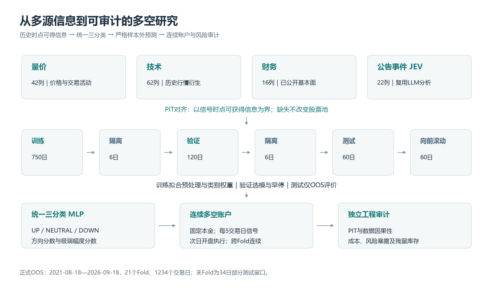
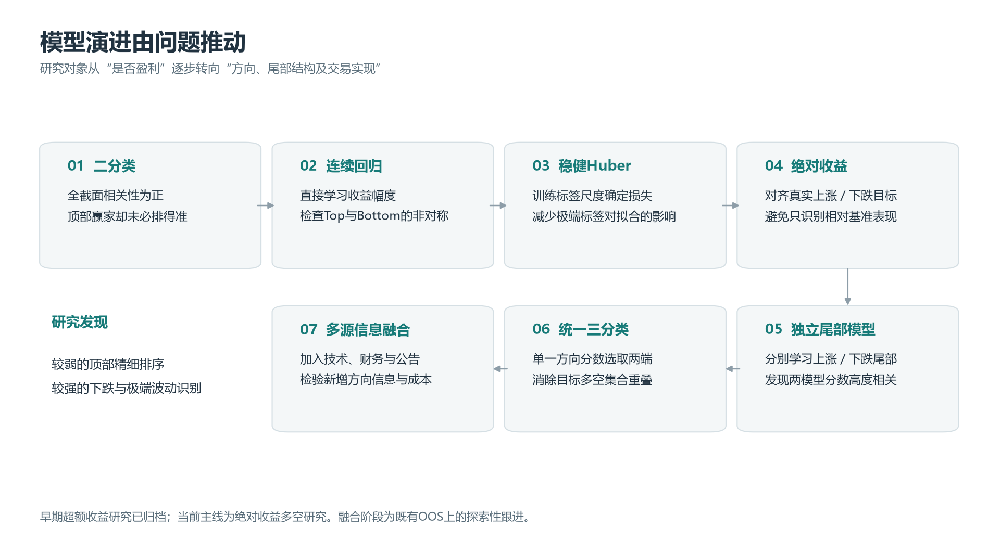
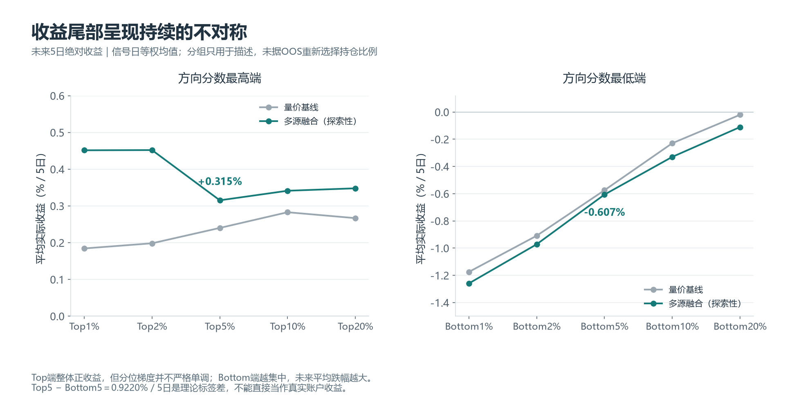
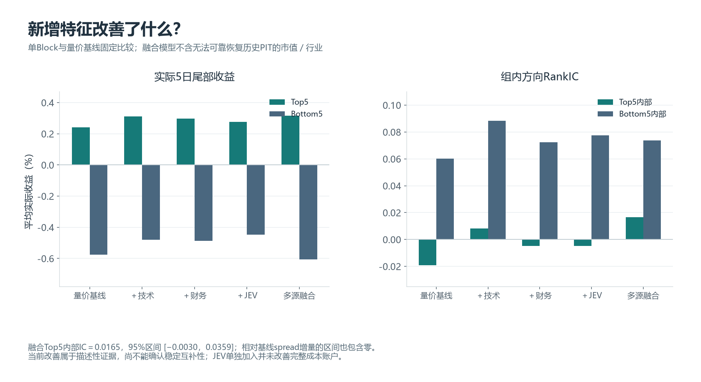
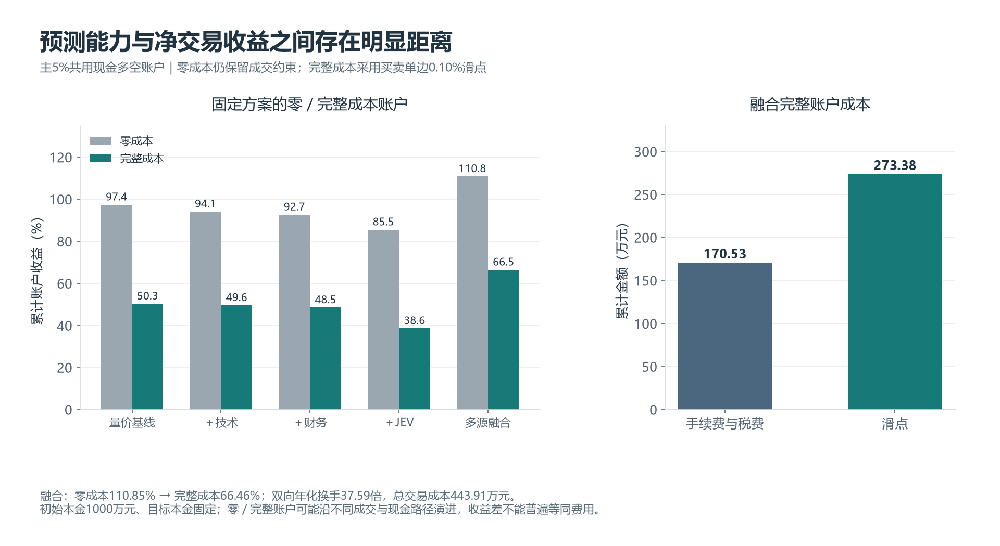
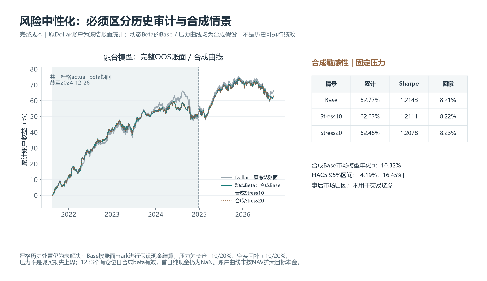

[English](README_EN.md) | 中文

# 基于多源信息融合的神经网络横截面收益预测与多空组合研究

**中证1000 · Walk-forward · MLP · LLM公告事件 · 多空组合 · 风险审计**

在之前做量化研究的时候，我脑袋里一直想回答一个很直接的问题：**神经网络能不能从A股的历史交易、基本面和公司公告中，学习到真正具有样本外预测能力的收益信号呢？** 所以我开始了这个项目的研究。
这个项目从最基础的量价 MLP 出发，逐步扩展到绝对收益三分类、多源信息融合、多空组合、交易成本和风险中性化。比起某一条收益曲线本身，我更关注的是模型从海量的数据中到底学到了什么，以及这些预测信息在进入真实交易约束后还能保留多少。

## 01 项目概览

**研究问题**：多源信息能否改善神经网络对股票涨跌的识别，同时保留已经较强的下跌端预测能力？  
**研究对象**：中证1000历史成分股，样本外区间为2021-08-18至2026-09-18，共21个Fold、1234个交易日。  
**研究方法**：从量价 MLP 开始，依次比较分类、回归和稳健回归，最终转向绝对收益 UP / NEUTRAL / DOWN 三分类，并加入技术、财务和LLM公告事件信息。  
**核心发现**：模型对下跌尾部和未来极端涨跌幅的识别明显强于顶部内部精细排序；多源融合进一步改善了部分方向指标和多空收益差。  
**验证边界**：融合模型属于在既有OOS上的探索性跟进；终端库存的合成情景与严格历史审计始终分开披露。

## 02 为什么做这个项目

项目最初并不是为了“训练一个收益最高的模型”。我更关心两个问题：**全截面预测相关性为正，是否真的意味着能挑出收益最好的股票？如果把换手、滑点和无法成交等现实约束加进去，模型的预测优势还能剩下多少？**

因此，我把整个研究放在同一条链条中考察：

**预测信号 → 尾部质量 → 组合构建 → 交易实现 → 净收益与风险**

这也意味着，我不会只看一个 RankIC，也不会只看一条累计收益曲线。全截面排序、Top / Bottom局部表现以及跨期连续账户，需要放在一起判断模型到底有没有实际价值。

## 03 数据体系

| 数据模块 | 规模 | 信息内容与研究作用 |
| --- | ---: | --- |
| 量价 | 42列 | 历史价格与交易活动，是所有模型的共同基线 |
| 技术指标 | 62列 | 从历史行情进一步提取趋势、波动和交易状态信息 |
| 财务基本面 | 16列 | 使用当时已经公开的财务信息，补充企业质量与经营状态 |
| 公告事件 JEV | 22列 | 复用LLM对公司公告的事件级结构化分析，包括方向、重要程度等信息 |

最终融合模型使用上述四类信息：候选142列，训练中实际保留139列；3列财务特征因源字段不足始终缺失。所有缺失处理都由训练集决定，不通过删除股票改变样本池。

JEV 按公告真正可获得的时间进行 PIT 对齐。我只复用已经完成的公告分析结果，不在模型训练阶段重新调用LLM，也不公开原始公告库、Prompt或详细评分实现。

历史市值和行业信息目前还无法可靠恢复完整的PIT变动，因此没有强行加入模型，也没有用当前行业快照回填历史。这一部分被明确保留为后续研究限制。

## 04 严格的 Walk-forward 研究设计

预测目标是股票 **T+1开盘至T+6开盘的绝对收益**。整个样本严格按照实际交易日滚动：

**Train 750 → Embargo 6 → Validation 120 → Embargo 6 → Test 60 → Step 60**

最后一个Fold因数据截止只有34个Test交易日。

每个Fold中，预处理和类别权重只由Train拟合；Validation只负责选参和早停；Test只用于样本外预测和评价。最终重训仍沿用Train阶段确定的预处理状态。历史成分股、财务披露时间和公告时间都按照当时可获得的信息处理。

完整账户使用全部1234个交易日的预测。涉及未来收益标签的诊断会排除尚未成熟的末端样本；尾部收益统计覆盖246个成熟调仓信号日，而方向／幅度IC使用每日成熟横截面。不同指标对应不同评价频率，我没有把它们混成同一个结论。

## 05 模型是如何一步步演进的

最初，我使用二分类模型预测股票未来是否跑赢基准。但很快出现了一个问题：**全截面 RankIC 为正，并不意味着最高分股票一定拥有最高收益。** 于是我继续尝试连续收益回归，希望模型能够学习“涨多少”，而不仅仅是“是否跑赢”。

随后引入 Robust Huber Regression 后，一个越来越稳定的现象出现了：**模型对未来表现较差的股票识别得明显更好，而顶部赢家内部仍然很难精细排序。** 这让我开始重新考虑标签本身，并把研究从相对基准的超额收益转向股票绝对收益。

接着，我分别训练 Upside 和 Downside 模型，却发现两边的分数高度相关，而且经常同时挑中同一批股票。这提示我：量价特征可能首先在识别“未来会不会发生大幅波动”，而不只是单纯判断上涨或下跌。

因此，我把两个独立模型合并成统一的 **UP / NEUTRAL / DOWN 三分类模型**。其中，UP / DOWN分别要求股票位于当日未来收益最高／最低10%，并且实际上涨／下跌；其余样本为NEUTRAL。

模型最终使用：

- `direction_score = P(up) − P(down)`：衡量一只股票更偏向上涨尾部还是下跌尾部；
- `extreme_score = P(up) + P(down)`：衡量一只股票未来出现大幅波动的可能性。

统一排序后，多头和空头目标集合不再重叠；方向是否真的有效，则继续由真实未来收益和连续账户检验。

## 06 核心研究发现

| 聚合指标 | 量价三分类基线 | 多源融合 |
| --- | ---: | ---: |
| Top5未来5日绝对收益 | +0.2401% | +0.3153% |
| Bottom5未来5日绝对收益 | -0.5749% | -0.6067% |
| Top5 − Bottom5理论差 | +0.8150% | +0.9220% |
| Top5内部方向RankIC | -0.0192 | 0.0165 |
| Bottom5内部方向RankIC | 0.0602 | 0.0738 |
| 每日全截面方向RankIC | 0.0691 | 0.0732 |
| 每日极端幅度RankIC | 0.3007 | 0.2933 |

尾部收益按真实信号日等权计算；组内RankIC是该组 `direction_score` 与实际绝对收益的Spearman相关；极端幅度RankIC则衡量 `extreme_score` 与未来绝对涨跌幅之间的关系。

### 1. 下跌端比上涨端更容易预测

这是整个项目里最稳定、也最值得关注的发现。

Bottom端呈现出比较清晰的收益梯度：模型认为越差的股票，未来实际收益通常也越低。相比之下，Top端虽然平均收益已经转正，但内部精细排序仍然弱得多。

多源融合后，Top5内部RankIC上升到0.0165，但HAC5 95%区间仍为 **[−0.0030，0.0359]**，还不能确认这一改善已经稳定成立。Top端不同分位的平均收益也并不严格单调。

### 2. 模型很擅长识别“未来会不会大幅波动”

`extreme_score` 与未来绝对涨跌幅的日均相关大约在0.29—0.30之间。这个结果说明，模型对未来价格波动幅度包含较强信息，但“知道会大幅波动”和“知道一定往哪个方向波动”并不是一回事。

### 3. 多源融合有改善，但不能简单理解为每类数据都独立贡献Alpha

技术、财务和公告信息单独加入后，都提高了Top5平均收益，但并没有同时改善全部指标。比如，JEV单独加入时完整成本累计收益为38.57%，低于量价基线的50.27%，因此不能据此声称LLM公告信息可以独立产生稳定Alpha。

最终融合模型相对量价基线的理论多空spread提高 **0.1071个百分点／5日**，但同日期配对HAC5 95%区间为 **[−0.1226，+0.3368]个百分点**，包含零，且没有做多重检验修正。

因此，我把这部分结果理解为**有方向性的探索性证据**，而不是已经得到独立确认的最终结论。

## 07 从预测到交易

主账户固定为 **Long Top5% + Short Bottom5%**。两边分别等权、共用现金，每5个实际交易日产生一次信号，次日开盘执行；账户、库存和调仓网格跨Fold连续，不会在Fold边界重置。

回测保留T+1、整手、现金、停牌、涨跌停和公司行动等交易约束。完整成本进一步加入佣金、历史印花税、过户费，以及**买卖单边0.10%的滑点假设**。零成本版本只移除费用和滑点，仍然保留真实成交约束。

| 主5%账户 | 成本版本 | 累计收益 | Sharpe | 最大回撤 |
| --- | --- | ---: | ---: | ---: |
| 量价基线 | 零成本 | 97.40% | 1.5837 | 8.72% |
| 量价基线 | 完整成本 | 50.27% | 0.8142 | 14.11% |
| 多源融合（探索性） | 零成本 | 110.85% | 1.9737 | 8.82% |
| 多源融合（探索性） | 完整成本 | 66.46% | 1.1788 | 11.30% |

这一步让我看到一个很现实的问题：**模型有预测能力，并不等于这些预测能力可以完整转化成可交易收益。**

融合模型完整成本账户的双向年化换手约37.59倍，手续费与税费约170.53万元，滑点约273.38万元，总成本约443.91万元，初始本金为1000万元。交易摩擦会明显侵蚀Gross Alpha。

理论上的Top5−Bottom5收益差为0.9220%／5日，但它不能直接等同于账户收益。50%多头＋50%空头的理想单期贡献只有理论spread的一半，真实账户还会受到连续持仓、成交失败和现金路径的影响。

## 08 风险中性化与鲁棒性

等额多空并不等于市场Beta中性。Long和Short可能天然拥有不同的市场暴露，因此我进一步比较了Dollar-neutral与动态Beta配权，并检查目标权重和实际成交库存之间的差异。

这个阶段也暴露出了一个真实的执行问题：两只长期停牌后的残留证券缺少足够信息去证明历史上的真实终端清算方式。为避免“为了得到完整曲线而人为补数据”，严格actual-beta结论只保留到2024-12-26；旧账户和模型全部冻结，没有删除残留仓位、前填Beta或假造市场价格。

> **下面的 Dynamic Beta Base、Stress10、Stress20 均为合成／假设会计情景，只用于统一时间跨度和做敏感性分析，并不是历史真实可执行绩效。**

| 融合完整成本账户 | 证据层级 | 累计收益 | 简单年化 | Sharpe | 最大回撤 |
| --- | --- | ---: | ---: | ---: | ---: |
| Dollar-neutral | 原冻结账面；完整actual-beta未验证 | 66.46% | 13.58% | 1.1788 | 11.30% |
| 动态Beta Base | **合成假设** | 62.77% | 12.83% | 1.2143 | 8.21% |
| 动态Beta Stress10 | **合成假设** | 62.63% | 12.80% | 1.2111 | 8.22% |
| 动态Beta Stress20 | **合成假设** | 62.48% | 12.77% | 1.2078 | 8.23% |

Base情景按已有账面估值结算残留库存；Stress10／20分别对多头结算价施加10%／20%折价、对空头回补施加相同幅度加价。结果与Base非常接近，只能说明策略对这一组固定压力假设不敏感，并不能把20%理解成现实损失的上界。

在合成Base情景下，事后市场模型的年化alpha为10.32%，HAC5 95%区间为[4.19%，16.45%]，市场Beta为−0.0257。这里的归因使用NAV日收益，与主绩效的固定本金口径不同，也从未用于交易选参。

对融合模型而言，动态Beta方案牺牲了一部分累计收益，但降低了回撤并提高Sharpe；量价基线则没有表现出同样的改善。这也说明，**降低Beta暴露并不会自动让所有模型变得更好。**

## 09 研究局限

我把这些结果看作一个完整研究流程的阶段性成果，而不是可以直接外推到真实A股实盘的结论。当前仍有几个明确限制：

- 空头侧假设股票可以借到，借券费为零，也没有完整模拟召回、保证金和强平；
- 历史行业PIT数据不足，因此还没有完成行业中性化；
- Phase 3F融合模型是在观察既有OOS结果后提出，属于探索性跟进，不是新的独立确认测试；
- Phase 4C是合成会计敏感性分析，真实终端处置仍然没有被历史数据完全解决；
- Top-tail内部排序和融合增量spread的统计区间仍包含零；
- 高换手、滑点和成交约束依然是Gross Alpha转化为Net Alpha的主要障碍。

这些限制并不是项目中被隐藏的问题，恰恰构成了下一步继续研究的方向。

## 10 下一步研究

如果继续推进这个项目，我会沿着两个方向深入：一是让模型更好地理解时间和不同信息模态，二是让预测信号更接近真正可执行的组合。

| 方向 | 研究目标 |
| --- | --- |
| TCN／Transformer | 从静态MLP扩展到量价时间序列，直接建模时间依赖和市场状态变化 |
| 多模态Fusion NN | 分别编码量价序列、技术、财务和公告事件，再通过融合层进行交互 |
| 多任务学习 | 联合训练Direction Head与Magnitude Head，分别回答“往哪边走”和“可能走多大” |
| 组合优化 | 把Beta、可靠历史行业、换手和交易成本直接放入组合约束 |
| 独立验证 | 在新的未观察时期重新验证融合增量，并继续补充真实借券和终端处置约束 |

更长远的目标是把项目从单一预测模型继续扩展成：

**神经网络信号 → 风险模型 → 组合构建 → 交易执行**

## 11 技术栈

Python · PyTorch · Pandas · NumPy · Walk-forward研究 · PIT数据对齐 · LLM公告事件特征 · 连续账户回测 · 独立完整性与执行风险审计

公开版只展示研究方法、聚合证据和研究局限。冻结来源、图表口径及披露范围见[公开披露审计](PUBLIC_DISCLOSURE_AUDIT.md)。
